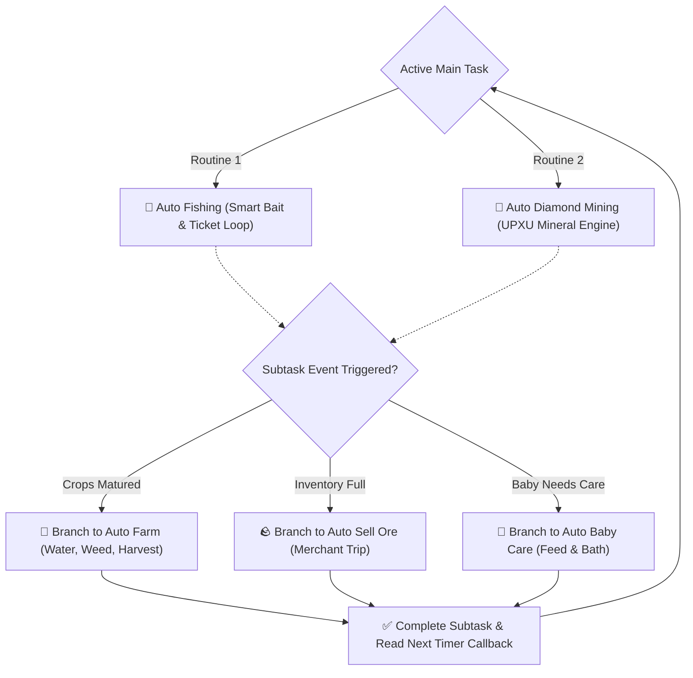
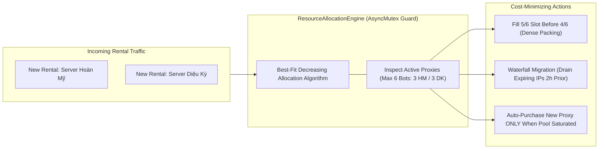

<div align="center">

# 🌾 Avatar Multi-Bot Manager & Cloud Automation Platform

### Enterprise-grade 24/7 background game automation, multi-tenant rental marketplace, cost-optimized proxy lifecycle, and real-time Porsche & Apple minimalist liquid glass web dashboard for Avatar 2D.

[](https://nodejs.org/)
[](https://orm.drizzle.team/)
[](https://adoptium.net/)
[](https://payos.vn/)
[](docs/DEPLOYMENT_GUIDE.md)
[](LICENSE)

[Overview](#-overview) · [Core Problems Solved](#-core-problems-solved) · [In-Game Automation Engine](#-in-game-automation-engine) · [Cost-Optimized Proxy Allocation](#-cost-optimized-proxy-allocation-engine) · [Rental SaaS & Billing](#-multi-tenant-rental-marketplace--billing) · [Architecture](#-engine-architecture) · [Quickstart](#-quickstart) · [Documentation Hub](#-documentation-hub) · [License](#-license)

</div>

---

## 🌟 Overview

**Avatar Multi-Bot Manager** is a complete, cloud-native automation platform and commercial rental management system designed for **Avatar 2D** (Teamobi). It orchestrates dozens to hundreds of persistent, headless game accounts running simultaneously on cloud servers, Linux VPS, or standard cPanel shared hosting without graphical display overhead.

The platform bridges an ultra-low-footprint **Java Headless Launcher** (~45MB RAM per bot instance) with an enterprise **Node.js Supervisor Core** handling process supervision, self-healing socket reconnections, cost-minimizing proxy bin-packing, and an automated 24/7 VietQR banking billing engine.

---

## 🎯 Core Problems Solved

### 1. Hardware Wear, High Electricity Costs & Battery Degradation
* **The Problem:** Traditionally, players and rental providers keep physical mobile phones or desktop Android emulators (Nox, LDPlayer) powered on 24/7. These heavy emulators consume gigabytes of memory and max out CPU cores, leading to thermal throttling, hardware degradation, and massive electricity bills.
* **The Solution:** The platform executes bots in headless Java Virtual Machine (JVM) micro-instances using MicroEmulator. It strips out all heavy windowing UI layers, running reliably on as little as **~45MB RAM per account**. A basic 2GB RAM cloud VPS can comfortably operate 30–40 bots continuously.

### 2. Socket Disconnections & Missed Yield Cycles
* **The Problem:** Unstable internet connections, server-side nightly maintenance, and socket drops cause unmonitored bots to disconnect. Crops wither, animals perish, fishing bait goes to waste, and limited-time event rewards are lost.
* **The Solution:** An autonomous **Self-Healing Watchdog** continuously detects socket teardowns and server disconnects, executing an intelligent **Exponential Backoff with Random Jitter** reconnect algorithm. Bots automatically log back in, restore their routine, and resume work without operator intervention.

### 3. Exploding Infrastructure Costs When Renting Out Bots
* **The Problem:** Naively assigning a dedicated proxy to every single rented bot multiplies proxy subscription costs, making commercial rental operations economically unprofitable.
* **The Solution:** Game servers permit multiple connections per IP up to defined thresholds (e.g., maximum 3 bots per server Hoàn Mỹ / Diệu Kỳ). The platform implements a **Best-Fit Decreasing Dynamic Bin-Packing Algorithm** alongside a **2-Hour Waterfall Migration Engine**, packing bots densely onto the minimum necessary proxy pool, auto-draining expired IPs, and purchasing new proxies on-demand only when existing capacity is saturated.

### 4. Manual Administration & Spreadsheet Overhead
* **The Problem:** Rental shop owners historically track account credentials, rental duration, and client payments using spreadsheets, manually editing MicroEmulator binary `.rs` RecordStore files.
* **The Solution:** A modern, multi-tenant SaaS portal where clients deposit funds via instant 24/7 VietQR banking, rent bot packages on-demand, adjust settings through a sleek web UI, and inspect real-time progress logs.

---

## 🤖 In-Game Automation Engine

Every account executes inside an isolated Java child process interacting directly with game mod bytecode (AngelChip ChipMix build13 & Fish build40) through binary RecordStore configuration and direct RAM extraction:



### 1. 🌾 Smart Crop & Livestock Farming (`Auto Farm` / `farm`)
* **Complete Automated Care:** Handles land plowing, seed planting, watering, weed pulling, pest removal, poultry and cattle feeding, egg harvesting, and milk collection.
* **Intelligent Harvest Scheduling:** Upon finishing farm chores, the engine inspects in-game crop timers directly from RAM (e.g., "crops mature in 23 minutes"). It schedules an exact local timer callback, frees the bot to switch to secondary tasks (such as fishing or mining) in the meantime, and automatically returns to the farm the exact moment crops ripen.

### 2. 🎣 Smart Fishing Engine (`Auto Fish` / `fish`)
* **Autonomous Supply Loop:** Automatically navigates to the fishing zone, monitors ticket and bait inventories, and purchases refills from vendors whenever depleted.
* **Precision Bite Detection:** Listens to game socket bite packets, executes rod retrieval with optimal timing, and offloads catches to vendors upon inventory saturation.

### 3. 💎 Diamond & Mineral Mining (`Auto KC` / `diamond` / `UPXU`)
* **Mine Shaft Automation:** Automates pickaxe acquisition, deep underground shaft navigation, rock breaking, and gemstone extraction (KCX, NHB).
* **Live Earning Metrics:** Continuously computes and broadcasts coin generation velocity per hour to the web dashboard.

### 4. 🪨 Inventory Offloading & Ore Selling (`Auto Bán Đá` / `sell_ore`)
* **Bag Capacity Sentry:** Detects inventory capacity thresholds during mining routines.
* **Seamless Merchant Trip:** Temporarily branches execution to visit the ore merchant, sells accumulated stone and gems, and immediately resumes mining.

### 5. 👶 Baby Care Routine (`Auto Em Bé` / `baby`)
* **Nurturing Automation:** Periodically checks infant status, feeding, bathing, and health maintenance routines according to configured schedules.

### 6. 🎁 Event Gift Hunter & RAM Telemetry (`Auto Event` / `SkGift`)
* **Zero-Latency RAM Extraction:** Reads event gift tallies directly from the mod's static memory structure (`SkGift.lastX` / `SkGift.lastY`) with $O(1)$ query speed.
* **Dual Real-time Metric Tracking:** Delivers concurrent progress bars for both Farm harvest drops and Fishing event drops on the web interface.
* **Harvest Anti-Ghosting Guard:** Anchors initial baseline silently (`prev < 0`) and guards checks by active task type (`lastAutoTask == 'farm'`), completely preventing fishing event counts from triggering false farm harvest logs when transitioning tasks.

### 7. 🔄 Cooperative Subtask Interleaving
* When assigned a primary long-running task (e.g., Auto Fishing or Auto Diamond Mining), the launcher dynamically pauses the main routine when a secondary priority arises (crops mature, ore bag is full, baby needs attention), executes the subtask, and seamlessly restores the primary workflow.

---

## 🌐 Cost-Optimized Proxy Allocation Engine

> [!NOTE]
> In this platform, proxies are managed primarily as an **optimal resource packing mechanism to minimize rental overhead**, not merely for ban evasion. The system maximizes utilization within server concurrency thresholds.



### Technical Highlights of Proxy Cost Minimization
1. **Best-Fit Decreasing (BFD) Allocation:** Rented accounts are sequentially assigned into existing active proxies with the highest load (filling $5/6$ slots before allocating $4/6$), minimizing the total count of simultaneously rented proxies.
2. **Strict Server-Level Balancing:** Each proxy supports up to 6 accounts, strictly balanced as maximum 3 accounts on Server Hoàn Mỹ (0) and 3 accounts on Server Diệu Kỳ (1), maximizing hardware and proxy efficiency.
3. **2-Hour Waterfall Migration:** The background cronjob (`ProxyLifecycleCron`) scans proxy expiration times. Exactly 2 hours prior to a proxy's expiration, bots bound to that proxy are automatically migrated to another healthy, active proxy on the same server, allowing expired proxies to drain naturally without renewal waste.
4. **On-Demand Procurement via proxy.vn:** New proxies are automatically purchased via API **only** when all active proxies are operating at 100% capacity ($\ge 6$ bots), preventing idle proxy expenses.

---

## 👥 Multi-Tenant Rental Marketplace & Billing

* **Instant 24/7 VietQR & payOS Top-Up:** Deposits are confirmed via webhook in under 2 seconds. Protected by HMAC-SHA256 signature verification and database transaction row locks (`SELECT ... FOR UPDATE`) preventing double-credit exploits.
* **Flexible Rental Tiers:**
  * **UPXU Plan:** Automated Diamond & Mineral Mining with coin accumulation.
  * **FISH Plan:** Smart Fishing with bait/ticket cycles and coin conversions.
  * **FULL Plan:** Unrestricted access to Farm, Fish, Diamond, Sell Ore, and Event automation.
* **Pro-Rata Daily Refund Engine:** Allows customers to cancel rented slots at any time, returning unused days back to their wallet balance automatically according to configured cancellation fee policies.

---

## 🛡️ Enterprise Architecture & Security

* **Non-blocking Asynchronous Rotating Logger (`RotatingFileAppender`):** Logs stream through an in-memory queue flushed every 800ms in batched streams, completely decoupling disk I/O from the Node.js event loop. Outputs are cleanly separated into `logs/app-YYYY-MM-DD.log` and `logs/error-YYYY-MM-DD.log`, with automated 7-day archive purging keeping disk consumption below 50MB.
* **In-Memory Ring Buffer (`CrossProcessBus`):** Retains up to 1,000 recent logs per account in RAM, enabling instant modal inspection in $< 0.5\text{ms}$ with zero disk lookups.
* **Multi-Tenant Session Isolation & Anti-Ghosting State:** On login, logout, and unauthorized events, React state vectors (`accounts`, `status`, `files`, `proxies`, `logs`) are deterministically purged, eliminating ghost accounts across different user sessions.
* **Server-Side Ownership Enforcement (RBAC):** Every mutating API endpoint (`start`, `stop`, `auto`, `setup`, `delete`, `reset`) validates `account.userId === req.user.sub`. Passwords are permanently masked as `******` across all public API envelopes.

---

## 🏗️ Engine Architecture


---

## 🚀 Quickstart

### 1. Clone & Install Dependencies

```bash
git clone https://github.com/hoangbmt023/auto-server-manager-avatar2d-angleChip.git
cd auto-server-manager-avatar2d-angleChip
npm install
```

### 2. Configure Environment (`.env`)

Copy the environment template:

```bash
cp .env.example .env.development
```

Update your MySQL connection parameters in `.env.development`:

```env
PORT=3001
DB_HOST=localhost
DB_PORT=3306
DB_USER=root
DB_PASSWORD=your_mysql_password
DB_NAME=avatar_2d_bot_manager
APP_SECRET=your_super_secret_32_character_key
```

### 3. Compile Java Engine & Launch

```bash
# Compile Java Headless Engine (Requires JDK 8 - 21)
node java-engine/build.js

# Development Mode (Includes Code-First Auto-Migration)
npm run dev

# Production Daemon
npm run prod
```

Access the dashboard at **`http://localhost:3001`**.

---

## 📖 Documentation Hub

Deep-dive operational and technical guides are maintained in the [`docs/`](docs/) directory:

| Document | Technical Coverage |
| :--- | :--- |
| [**System Design & Execution Pipeline**](docs/SYSTEM_DESIGN.md) | Multi-process supervisor, binary `.rs` RecordStore format, dual-canvas graphics, IPC protocol, `SkGift` RAM telemetry, and Watchdog backoff algorithms |
| [**Rental Engine & Proxy Lifecycle**](docs/RENTAL_AND_PROXY_LIFECYCLE.md) | Best-Fit Decreasing packing, 2-hour Waterfall Migration rules, pro-rata refund mathematics, and abuse prevention |
| [**RESTful API & Event Specification**](docs/API_SPECIFICATION.md) | Complete endpoint catalog, Server-Sent Events (SSE) schemas, payload structures, and payOS webhook verification |
| [**Database Schema & Persistence**](docs/DATABASE.md) | MySQL Entity Relationship Diagram (ERD), tables, indexing strategies, and automated schema migrations |
| [**Production Deployment Guide**](docs/DEPLOYMENT_GUIDE.md) | Step-by-step instructions for cPanel Hosting (Setup Node.js App), Linux VPS (Systemd), and Windows Workstation |
| [**UI/UX Design Engine**](docs/DESIGN.md) | Porsche & Apple Minimalist design tokens, split layout, theme tokens, and SVG vector iconography |

---

## 💻 Deployment Options

* **cPanel Shared Hosting**: Deploys directly via **Setup Node.js App** (Phusion Passenger wrapper `app.js`). Runs with zero root requirements using self-contained portable OpenJDK. See the [cPanel Deployment Guide](docs/DEPLOYMENT_GUIDE.md#2-deploying-on-cpanel-via-setup-nodejs-app).
* **Linux VPS (Ubuntu / Debian)**: Supervises bot daemons via `systemd` or PM2 with headless virtual framebuffer. See the [Linux VPS Guide](docs/DEPLOYMENT_GUIDE.md#3-deploying-on-linux-vps-ubuntu-2204--debian-12).
* **Windows Workstation**: Executes natively using PowerShell / CMD with installed Node.js and JDK.

---

## 📄 License

This project is licensed under the [MIT License](LICENSE).
