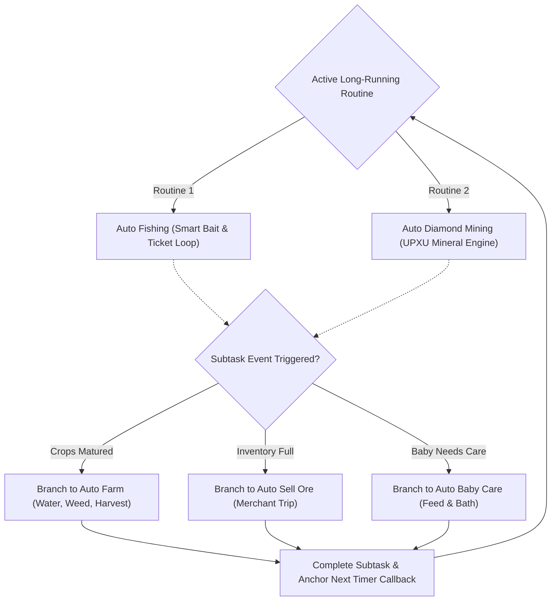
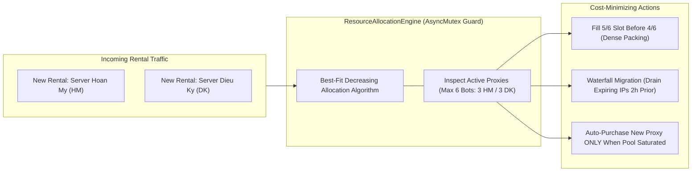

<div align="center">

# Avatar Multi-Bot Manager & Cloud Automation Platform

> Enterprise-grade 24/7 background game automation, multi-tenant rental marketplace, cost-optimized proxy lifecycle, and real-time liquid glass web dashboard for Avatar 2D.

[](https://nodejs.org/)
[](https://orm.drizzle.team/)
[](https://adoptium.net/)
[](https://payos.vn/)
[](docs/DEPLOYMENT_GUIDE.md)
[](LICENSE)

[System Overview](#1-system-overview) · [Core Problems Solved](#2-core-problems-solved--motivation) · [In-Game Automation Engine](#3-in-game-automation-engine--subtask-interleaving) · [Cost-Optimized Proxy Allocation](#4-cost-optimized-proxy-allocation-engine) · [Rental SaaS & Billing](#5-multi-tenant-rental-marketplace--billing-engine) · [Engine Architecture](#6-high-level-engine-architecture) · [Reliability & Security](#7-reliability-structured-logging--security-guards) · [Quickstart](#8-quickstart-guide) · [Documentation Hub](#9-documentation-hub) · [License](#10-license)

</div>

---

## 1. System Overview

**Avatar Multi-Bot Manager** is a cloud-native background execution daemon, multi-tenant rental marketplace, and operations platform for **Avatar 2D** (Teamobi). It coordinates dozens to hundreds of persistent, headless game accounts running concurrently across cloud Virtual Private Servers (VPS), Linux servers, or standard cPanel shared hosting environments with zero graphical display overhead.

The platform bridges an ultra-low-footprint **Java Headless Launcher** (~45MB RAM per bot instance) with an enterprise **Node.js Supervisor Core** providing:
* Automated, continuous game execution routines (Farming, Fishing, Mining, Ore Selling, Child Care, Event Gift Hunting).
* Dynamic subtask interleaving that temporarily branches long-running tasks for short-cycle chores without state loss.
* Cost-minimizing proxy bin-packing and automated lifecycle management.
* A complete commercial rental portal with instant 24/7 VietQR banking top-ups and pro-rata refunds.
* A Porsche and Apple Minimalist split-layout web interface with real-time Server-Sent Events (SSE) telemetry.

---

## 2. Core Problems Solved & Motivation

### 2.1. Hardware Wear, High Electricity Costs & Battery Degradation
* **The Problem:** Traditionally, individual players and commercial rental operators keep physical mobile devices or desktop Android emulators (such as Nox or LDPlayer) running 24/7. These heavy emulators consume gigabytes of memory and max out CPU cores, leading to thermal throttling, hardware degradation, and substantial electricity costs.
* **The Solution:** The platform runs bots within headless Java Virtual Machine (JVM) micro-instances using MicroEmulator. By stripping away graphical windowing layers and rendering off-screen buffers only on-demand, each bot operates at approximately **~45MB RAM**. A budget 2GB RAM cloud VPS can reliably sustain 30 to 40 accounts simultaneously.

### 2.2. Socket Disconnections & Missed Yield Cycles
* **The Problem:** Unstable internet connections, nightly game server maintenance, and transient socket drops cause unmonitored bots to disconnect. Crops wither, livestock starve, fishing bait expires, and limited-time seasonal event rewards are permanently lost.
* **The Solution:** An autonomous **Self-Healing Watchdog** detects socket drops, connection resets, and maintenance kicks. It schedules automatic reconnections using an **Exponential Backoff with Random Jitter** algorithm, restoring gameplay routines, re-synchronizing coordinates, and resuming operations without manual operator intervention.

### 2.3. Exploding Infrastructure Costs in Rental Operations
* **The Problem:** Allocating an individual dedicated proxy to every rented account multiplies recurring infrastructure expenses, rendering commercial bot-rental services unprofitable.
* **The Solution:** Game servers permit multiple connections per IP up to defined thresholds (e.g., maximum 3 bots per server: Hoan My [HM] / Dieu Ky [DK]). Rather than treating proxies merely as an anti-ban measure, the platform implements a **Best-Fit Decreasing Dynamic Bin-Packing Algorithm** and a **2-Hour Waterfall Migration Engine**. This packs accounts densely onto the minimum necessary proxy pool, auto-drains expiring IPs, and orders new proxies on-demand only when capacity is fully saturated.

### 2.4. Manual Administration & Spreadsheet Overhead
* **The Problem:** Rental operators historically track customer credentials, expiration dates, and payments using spreadsheets, while manually generating MicroEmulator binary `.rs` RecordStore files.
* **The Solution:** A fully automated multi-tenant SaaS portal where customers register, deposit via automated VietQR banking, rent bot packages on-demand, adjust settings through a clean web dashboard, and inspect live progress logs.

---

## 3. In-Game Automation Engine & Subtask Interleaving

Every account executes inside an isolated Java child process interacting directly with game mod bytecode (AngelChip ChipMix build13 and Fish build40) through binary RecordStore configurations and direct RAM extraction:



### 3.1. Smart Crop & Livestock Farming (`Auto Farm` / `farm`)
* **Complete Automated Maintenance:** Performs automated land tilling, seed sowing, watering, weed eradication, pest elimination, poultry/cattle feeding, egg collection, and milk harvesting.
* **Intelligent Harvest Scheduling:** Following chore completion, the engine inspects crop maturation timers directly from RAM (e.g., "crops ripen in 23 minutes"). It establishes a precise local timer callback, yields execution so the bot can switch to secondary activities (such as fishing or mining) in the interim, and automatically returns to the farm the exact moment crops mature.

### 3.2. Smart Fishing Engine (`Auto Fish` / `fish`)
* **Autonomous Supply Loop:** Navigates autonomously to the fishing zone, monitors ticket and bait stock, and replenishes supplies from vendors whenever depleted.
* **Socket Bite Detection:** Intercepts game socket bite packets, executes rod retrieval with optimal latency, and offloads catches to merchants upon inventory saturation.

### 3.3. Diamond & Mineral Mining (`Auto Mining` / `diamond` / `UPXU`)
* **Underground Shaft Automation:** Automates pickaxe acquisition, deep underground shaft navigation, rock breaking, and gemstone extraction (KCX, NHB).
* **Live Velocity Telemetry:** Continuously computes and broadcasts coin generation velocity per hour to the web dashboard.

### 3.4. Automatic Ore Selling & Inventory Offloading (`Auto Sell Ore` / `sell_ore`)
* **Capacity Sentry:** Detects inventory capacity thresholds during active mining routines.
* **Merchant Trip:** Temporarily branches execution to visit the mineral merchant, sells accumulated stone and gems, and immediately resumes mining.

### 3.5. Automated Infant Care Routine (`Auto Baby Care` / `baby`)
* **Nurturing Automation:** Periodically verifies infant status, feeding, bathing, and health maintenance routines according to configured schedules.

### 3.6. Event Gift Hunter & RAM Telemetry (`Auto Event` / `SkGift`)
* **Zero-Latency RAM Extraction:** Reads event gift tallies directly from the mod's static memory structure (`SkGift.lastX` / `SkGift.lastY`) with $O(1)$ query speed.
* **Dual Real-time Metric Tracking:** Delivers concurrent progress metrics for both Farm harvest drops and Fishing event drops on the web interface.
* **Harvest Anti-Ghosting Guard:** Anchors the initial baseline silently (`prev < 0`) and guards checks by active task type (`lastAutoTask == 'farm'`), completely preventing fishing event counts from triggering false farm harvest logs during task transitions.

### 3.7. Cooperative Subtask Interleaving
* When assigned a primary long-running task (e.g., Auto Fishing or Auto Diamond Mining), the launcher dynamically pauses the main routine when a secondary priority arises (crops mature, ore bag is full, baby needs attention), executes the subtask, and seamlessly restores the primary workflow.

---

## 4. Cost-Optimized Proxy Allocation Engine

> [!NOTE]
> In this platform, proxies are managed primarily as an **optimal resource packing mechanism to minimize rental overhead**, not merely for ban evasion. The system maximizes utilization within server concurrency thresholds.



### 4.1. Best-Fit Decreasing (BFD) Allocation
Rented accounts are sequentially assigned into existing active proxies with the highest load (filling $5/6$ slots before allocating $4/6$), minimizing the total count of simultaneously rented proxies across the infrastructure.

### 4.2. Strict Server-Level Balancing
Each proxy supports up to 6 accounts, strictly balanced as maximum 3 accounts on Server Hoan My (0) and 3 accounts on Server Dieu Ky (1), maximizing hardware and proxy efficiency without exceeding server socket limits.

### 4.3. 2-Hour Waterfall Migration
The background cronjob (`ProxyLifecycleCron`) scans proxy expiration times. Exactly 2 hours prior to a proxy's expiration, bots bound to that proxy are automatically migrated to another healthy, active proxy on the same server, allowing expired proxies to drain naturally without renewal waste.

### 4.4. On-Demand Procurement via proxy.vn
New proxies are automatically purchased via API **only** when all active proxies are operating at 100% capacity ($\ge 6$ bots), preventing idle proxy expenses.

---

## 5. Multi-Tenant Rental Marketplace & Billing Engine

* **Instant 24/7 VietQR & payOS Top-Up:** Deposits are confirmed via webhook in under 2 seconds. Protected by HMAC-SHA256 signature verification and database transaction row locks (`SELECT ... FOR UPDATE`) preventing duplicate crediting exploits.
* **Flexible Rental Tiers:**
  * **UPXU Plan:** Automated Diamond and Mineral Mining with coin accumulation.
  * **FISH Plan:** Smart Fishing with automated bait and ticket cycles.
  * **FULL Plan:** Unrestricted access to Farm, Fish, Diamond, Sell Ore, and Event automation.
* **Pro-Rata Daily Refund Engine:** Allows customers to cancel rented slots at any time, returning unused days back to their wallet balance automatically according to configured cancellation fee policies:

$$\text{Refund} = \left(\frac{\Delta t_{\text{remaining}}}{T_{\text{month}}} \times P_{\text{effective}}\right) \times \left(1 - \frac{F_{\text{fee}}}{100}\right)$$

---

## 6. High-Level Engine Architecture


---

## 7. Reliability, Structured Logging & Security Guards

### 7.1. Non-blocking Asynchronous Rotating Logger (`RotatingFileAppender`)
Logs stream through an in-memory queue flushed every 800ms in batched streams, completely decoupling disk I/O from the Node.js event loop:
* General activity: `logs/app-YYYY-MM-DD.log` (Info, warnings, lifecycle transitions).
* Critical exceptions: `logs/error-YYYY-MM-DD.log` (Full error stack, deep cause metadata `err.cause`, SQL state, socket error codes).
* Automated 7-day retention cleanup: Prunes log archives older than 7 days, maintaining disk usage under 50MB.

### 7.2. In-Memory Ring Buffer (`CrossProcessBus`)
Retains up to 1,000 recent logs per account in RAM, enabling instant modal inspection in $< 0.5\text{ms}$ with zero disk lookups.

### 7.3. Multi-Tenant Session Isolation & Anti-Ghosting State
On login, logout, and unauthorized events, React state vectors (`accounts`, `status`, `files`, `proxies`, `logs`) are deterministically purged, eliminating ghost accounts across different user sessions. `UserDashboardPage` applies strict client-side ownership verification (`a.userId === currentUser.id`) as defense-in-depth.

### 7.4. Server-Side Ownership Enforcement (RBAC)
Every mutating API endpoint (`start`, `stop`, `auto`, `setup`, `delete`, `reset`) validates `account.userId === req.user.sub`. Passwords are permanently masked as `******` across all public API envelopes.

---

## 8. Quickstart Guide

### 8.1. Clone & Install Dependencies

```bash
git clone https://github.com/hoangbmt023/auto-server-manager-avatar2d-angleChip.git
cd auto-server-manager-avatar2d-angleChip
npm install
```

### 8.2. Configure Environment (`.env`)

Copy the environment template:

```bash
cp .env.example .env.development
```

Update your MySQL connection parameters in `.env.development`:

```env
PORT=3001
DB_HOST=localhost
DB_PORT=3306
DB_USER=root
DB_PASSWORD=your_mysql_password
DB_NAME=avatar_2d_bot_manager
APP_SECRET=your_super_secret_32_character_key
```

### 8.3. Compile Java Engine & Launch

```bash
# Compile Java Headless Engine (Requires JDK 8 - 21)
node java-engine/build.js

# Development Mode (Includes Code-First Auto-Migration)
npm run dev

# Production Daemon
npm run prod
```

Access the dashboard at **`http://localhost:3001`**.

---

## 9. Documentation Hub

Deep-dive operational and technical guides are maintained in the [`docs/`](docs/) directory:

| Document | Technical Coverage |
| :--- | :--- |
| [**System Design & Execution Pipeline**](docs/SYSTEM_DESIGN.md) | Multi-process supervisor, binary `.rs` RecordStore format, dual-canvas graphics, IPC protocol, `SkGift` RAM telemetry, and Watchdog backoff algorithms |
| [**Rental Engine & Proxy Lifecycle**](docs/RENTAL_AND_PROXY_LIFECYCLE.md) | Best-Fit Decreasing packing, 2-hour Waterfall Migration rules, pro-rata refund mathematics, and abuse prevention |
| [**RESTful API & Event Specification**](docs/API_SPECIFICATION.md) | Complete endpoint catalog, Server-Sent Events (SSE) schemas, payload structures, and payOS webhook verification |
| [**Database Schema & Persistence**](docs/DATABASE.md) | MySQL Entity Relationship Diagram (ERD), tables, indexing strategies, and automated schema migrations |
| [**Production Deployment Guide**](docs/DEPLOYMENT_GUIDE.md) | Step-by-step instructions for cPanel Hosting (Setup Node.js App), Linux VPS (Systemd), and Windows Workstation |
| [**UI/UX Design Engine**](docs/DESIGN.md) | Porsche & Apple Minimalist design tokens, split layout, theme tokens, and SVG vector iconography |

---

## 10. Deployment Options

* **cPanel Shared Hosting**: Deploys directly via **Setup Node.js App** (Phusion Passenger wrapper `app.js`). Runs with zero root requirements using self-contained portable OpenJDK. See the [cPanel Deployment Guide](docs/DEPLOYMENT_GUIDE.md#2-deploying-on-cpanel-via-setup-nodejs-app).
* **Linux VPS (Ubuntu / Debian)**: Supervises bot daemons via `systemd` or PM2 with headless virtual framebuffer. See the [Linux VPS Guide](docs/DEPLOYMENT_GUIDE.md#3-deploying-on-linux-vps-ubuntu-2204--debian-12).
* **Windows Workstation**: Executes natively using PowerShell / CMD with installed Node.js and JDK.

---

## 11. License

This project is licensed under the [MIT License](LICENSE).
