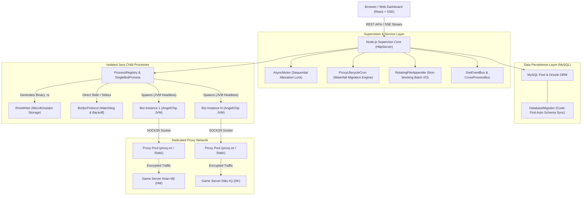

<div align="center">

# 🌾 Avatar Multi-Bot Manager & Cloud Automation Platform

### Nền tảng tự động hóa game Avatar 2D trên nền tảng đám mây (Cloud), tích hợp hệ sinh thái cày thuê thương mại 24/7, cổng thanh toán VietQR tự động và bảng điều khiển trực quan phong cách Porsche & Apple Minimalist.

[](https://nodejs.org/)
[](https://orm.drizzle.team/)
[](https://adoptium.net/)
[](https://payos.vn/)
[](docs/DEPLOYMENT_GUIDE.md)
[](LICENSE)

[Giới thiệu](#-giới-thiệu-tổng-quan) · [Bài toán giải quyết](#-bài-toán-thực-tế--hệ-thống-sinh-ra-để-làm-gì) · [Các chức năng chính](#-các-chức-năng-cốt-lõi--cách-hoạt-động) · [Điểm kỹ thuật nổi bật](#-những-điểm-nổi-bật--đột-phá-kỹ-thuật) · [Kiến trúc hệ thống](#-kiến-trúc-hệ-thống-architecture) · [Cài đặt nhanh](#-hướng-dẫn-khởi-chạy-nhanh-quickstart) · [Tài liệu](#-kho-tài-liệu-kỹ-thuật-docs)

</div>

---

## 🌟 Giới thiệu Tổng quan

**Avatar Multi-Bot Manager** là một giải pháp toàn diện cho phép chạy nền hàng chục đến hàng trăm tài khoản game **Avatar 2D** (Teamobi) đồng thời trên máy chủ đám mây (VPS, Linux Server hoặc cả Hosting cPanel) mà không cần mở giả lập đồ họa nặng nề.

Hệ thống kết hợp giữa **Java Headless Launcher** (chạy ngầm MicroEmulator siêu nhẹ chỉ ~45MB RAM/tài khoản) và một **Node.js Supervisor Core** điều phối toàn diện: từ quản lý tiến trình, tự phục hồi khi mất kết nối, phân bổ Proxy chống khóa nick, đến một hệ thống **SaaS cày thuê** có tích hợp nạp tiền tự động qua QR Code ngân hàng.

---

## 🎯 Bài toán Thực tế & Hệ thống sinh ra để làm gì?

### 1. Vấn đề của người chơi và người làm dịch vụ cày thuê Avatar
* **Tốn điện, hại máy:** Treo nick bằng điện thoại hoặc giả lập Android (Nox, LDPlayer) trên máy tính ngốn hàng gigabyte RAM, CPU lúc nào cũng 100%, máy nóng và hao pin liên tục 24/7.
* **Mất kết nối & Lỡ giờ thu hoạch:** Mạng chập chờn, game server bảo trì khiến bot bị ngắt kết nối mà người dùng không hay biết, dẫn đến chết cây trồng, hỏng trứng, lỡ chuyến câu cá hoặc hết thời gian sự kiện.
* **Nguy cơ khóa nick do trùng IP:** Đăng nhập quá nhiều tài khoản trên cùng một địa chỉ mạng internet gia đình rất dễ bị hệ thống bảo mật của Teamobi quét và khóa tài khoản hàng loạt.
* **Khó khăn khi kinh doanh cày thuê:** Người làm dịch vụ phải quản lý danh sách nick bằng Excel hoặc ghi nhớ thủ công, tự canh giờ nạp/hết hạn của khách, cấu hình mod RMS lắt léo và dễ nhầm lẫn.

### 2. Giải pháp của Avatar Multi-Bot Manager
* **Treo nick Headless siêu tiết kiệm:** Đưa toàn bộ tiến trình lên máy chủ chạy ngầm 100%. 1 VPS 2GB RAM có thể treo mượt mà 30 - 40 nick liên tục.
* **Tự động hóa hoàn toàn (Auto Farm, Cá, KC, Event):** Tự canh thời gian cây chín chính xác đến từng giây, tự mua mồi, tự giật cần câu cá, tự đào mỏ kim cương, tự nhặt quà sự kiện.
* **Watchdog tự phục hồi (Self-Healing):** Khi game mất kết nối hoặc máy chủ bảo trì, hệ thống tự động nhận diện và thử kết nối lại thông minh theo thuật toán giãn cách (Exponential Backoff + Jitter), không để nick bị rớt.
* **Hạ tầng Proxy độc lập:** Mỗi nhóm tài khoản chạy qua 1 Proxy riêng biệt (SOCKS5/HTTP), cách ly hoàn toàn IP giữa các file hồ sơ.
* **Mô hình SaaS tự động hóa thương mại:** Khách hàng tự nạp tiền qua VietQR quét mã là tiền vào ví sau 2 giây, tự chọn gói thuê (Up Xu, Câu Cá, Full Auto), tự theo dõi tiến độ, xem nhật ký thời gian thực và tự gia hạn nick mà không cần admin can thiệp thủ công.

---

## ⚙️ Các Chức năng Cốt lõi & Cách Hoạt động

### 1. 🤖 Bộ Máy Tự Động Hóa Game (Smart Headless Game Engine)
Mỗi tài khoản được khởi chạy trong một tiến trình Java độc lập, kết nối với Mod Game (ChipMix build13 / Fish build40) thông qua tầng giao tiếp nhị phân:
* **🌾 Auto Farm Thông Minh (Nông trại):**
  * Tự động chăm sóc toàn bộ nông trại: tưới nước, diệt sâu, nhổ cỏ, cho gà/bò/vịt ăn, thu hoạch trứng và sữa.
  * **Hẹn giờ thu hoạch tự động:** Sau khi chăm sóc xong, bot đọc thời gian cây trồng chín từ RAM game (ví dụ: còn 23 phút) và tự động đặt lịch hẹn giờ quay lại thu hoạch đúng lúc, thời gian còn lại bot có thể chuyển sang câu cá hoặc đào mỏ để tối ưu tài nguyên!
* **🎣 Auto Câu Cá Chuyên Nghiệp (Smart Fishing):**
  * Tự động di chuyển đến khu vực câu cá, tự mua vé câu, tự mua mồi câu khi hết.
  * Tự động giật cần khi cá cắn câu và bán cá sạch rương khi đầy để tiếp tục chu kỳ.
* **💎 Auto Đào Kim Cương (Mine UPXU):**
  * Tự động vào khu mỏ ngọc, sử dụng cuốc, đào khoáng sản kiếm đá và kim cương xanh (KCX).
  * Tự động đổi bán đá lấy xu và hiển thị tốc độ cày xu thực tế trên giao diện.
* **🎁 Auto Săn Quà Sự Kiện (Event Gift Hunter):**
  * Đọc trực tiếp biến đếm tích lũy sự kiện từ RAM mod (`SkGift.lastX` / `SkGift.lastY`) với độ trễ 0ms.
  * Tự động đồng bộ tiến độ nhận quà hàng ngày (ví dụ: `42/120`) và hiển thị thanh tiến độ kép trực quan cho cả Nông trại và Câu cá.
  * Cơ chế chống log ảo thông minh: Chỉ xuất thông báo khi thực sự hoàn thành đợt thu hoạch, không lấy nhầm số lượng từ các hoạt động khác khi đổi trạng thái auto.

---

### 2. 👥 Cổng Dịch Vụ Thuê Bot & Nạp Tiền Tự Động (Multi-Tenant SaaS)
* **Thanh toán VietQR & payOS 24/7:**
  * Khách hàng quét mã QR ngân hàng bất kỳ, tiền tự động cộng vào tài khoản trong vòng 2 giây nhờ cơ chế Webhook bảo mật HMAC-SHA256 kết hợp khóa chống trùng lặp (Idempotency Row Lock).
* **Thuê nick tự phục vụ (Self-Service Rental):**
  * Khách hàng tự chọn gói phù hợp: **Gói Úp Xu** (chỉ đào mỏ), **Gói Câu Cá**, hoặc **Gói Full Auto** (toàn quyền tất cả tính năng).
  * Thuật toán phân bổ tài nguyên tự động (**Best-Fit Decreasing**) gán nick vào đúng Server (Hoàn Mỹ hoặc Diệu Kỳ), chọn File hồ sơ trống và cấp Proxy còn sống.
* **Quản lý linh hoạt & Hoàn tiền theo ngày (Pro-rata Refund):**
  * Cho phép người dùng dừng nick, đổi cài đặt, gia hạn ngày thuê hoặc hủy slot nhận lại tiền thừa vào ví tương ứng với số ngày chưa sử dụng.

---

### 3. 🌐 Quản trị Proxy Tự Động (Autonomous Proxy Lifecycle)
* **Vòng đời Proxy khép kín 3 giai đoạn:**
  * Hệ thống Cronjob chạy ngầm tự động quét và kiểm tra sức khỏe của từng Proxy.
  * **Waterfall Migration (Chuyển tiếp 2 giờ):** Trước khi Proxy hết hạn 2 giờ, hệ thống tự động tìm Proxy mới khả dụng cùng Server để chuyển các nick sang, duy trì trạng thái online liên tục không bị gián đoạn.
  * Tự động gia hạn hoặc thanh lý Proxy qua API của nhà cung cấp (proxy.vn) để tối ưu chi phí hạ tầng.

---

### 4. 🖥️ Bảng Điều Khiển Trực Quan (Porsche & Apple Minimalist UI)
* **Giao diện Thiết kế Đẳng cấp:**
  * Phong cách tối giản, bố cục chia 2 cột sang trọng (Sidebar quản lý bên trái, danh sách nick và console bên phải).
  * Hỗ trợ đầy đủ chế độ Sáng / Tối (Dark / Light Mode) với độ tương phản cao, chuyển đổi êm ái.
  * Sử dụng 100% Vector SVG Icons sắc nét chuẩn Retina trên mọi màn hình.
* **Terminal Console Thời Gian Thực (Live SSE Stream):**
  * Truyền phát nhật ký máy chủ và nhật ký game trực tiếp lên trình duyệt qua Server-Sent Events (SSE) với độ trễ dưới 0.5 giây.
  * Tự động bóc tách các ký hiệu nhận diện và render huy hiệu màu riêng biệt cho từng loại hoạt động: `[FARM]`, `[CÂU CÁ]`, `[ĐÁ/KC]`, `[SỰ KIỆN]`, `[LỖI]`, `[KẾT NỐI]`.
* **Thẻ Nhật Ký Chi Tiết Từng Tài Khoản (`AccountLogsModal`):**
  * Người dùng bấm vào từng nick để xem nhật ký riêng của nick đó, kèm thanh tiến độ quà sự kiện và các chỉ số tiền cày được trong ngày.

---

### 5. 🛡️ Kiến trúc Ghi Log & Bảo Mật Đa Tầng (Enterprise Security)
* **Ghi log xoay vòng không nghẽn máy (`RotatingFileAppender`):**
  * Toàn bộ log được gom qua bộ đệm bộ nhớ và ghi bất đồng bộ (batch flush 800ms/lần), không gây nghẽn luồng xử lý Node.js.
  * Phân tách 2 file: `logs/app-YYYY-MM-DD.log` (hoạt động) và `logs/error-YYYY-MM-DD.log` (lỗi hệ thống & nguyên nhân chi tiết).
  * Tự động xóa dọn log cũ sau 7 ngày, đảm bảo dung lượng lưu trữ trên VPS/Hosting luôn dưới 50MB.
* **Phân quyền người dùng (RBAC) & Bảo vệ sở hữu nghiêm ngặt:**
  * Phân tách quyền rõ ràng giữa **Quản trị viên (Admin)** và **Người thuê (User)**.
  * Mọi API thao tác (chạy bot, dừng bot, sửa nick, xóa nick, xem log) đều kiểm tra quyền sở hữu `userId === req.user.sub`. Người dùng thông thường **tuyệt đối không thể can thiệp hay xem nick của người khác**.
  * Mật khẩu tài khoản game luôn được che chắn thành `******` trước khi trả về máy khách.
* **Cô lập phiên làm việc (Session Isolation):**
  * Tự động dọn sạch bộ nhớ đệm trên trình duyệt khi chuyển đổi tài khoản hoặc đăng xuất, ngăn ngừa hiện tượng lưu vết tài khoản giữa các phiên đăng nhập.

---

## 💎 Những Điểm Nổi Bật & Đột Phá Kỹ Thuật

| Điểm nổi bật | Chi tiết kỹ thuật |
| :--- | :--- |
| **🚀 Siêu nhẹ & Tiết kiệm RAM** | Sử dụng OpenJDK headless chạy MicroEmulator tinh gọn: chỉ tốn **~45MB RAM / tài khoản** (thay vì 500MB – 1GB như giả lập Android). |
| **⚡ Đọc RAM Mod Trực Tiếp** | Đọc dữ liệu sự kiện và chỉ số người chơi trực tiếp từ RAM game (`AvatarModAdapter` & `SkGift`) theo độ phức tạp $O(1)$, không cần hook can thiệp nguy hiểm. |
| **🔄 Self-Healing Watchdog** | Nhận diện mất kết nối và tự động đăng nhập lại theo thuật toán **Exponential Backoff + Jitter**, chống hiện tượng bão kết nối (thundering herd) làm sập cổng game. |
| **📦 100% MySQL Relational** | Lưu trữ hoàn toàn trên cơ sở dữ liệu MySQL thông qua Drizzle ORM, loại bỏ triệt để xung đột khóa file (`config.json`). |
| **🌐 Triển khai Không cần Root** | Chạy mượt mà trên môi trường **cPanel Shared Hosting** thông qua *Setup Node.js App* (Phusion Passenger) với Java Portable tích hợp sẵn. |
| **💰 Thanh toán Tự Động 2 Giây** | Tích hợp cổng thanh toán payOS với chữ ký điện tử HMAC-SHA256 và khóa giao dịch chống cộng tiền 2 lần. |

---

## 🏗️ Kiến Trúc Hệ Thống (Architecture)



---

## 🚀 Hướng Dẫn Khởi Chạy Nhanh (Quickstart)

### 1. Tải mã nguồn & Cài đặt thư viện

```bash
git clone https://github.com/hoangbmt023/auto-server-manager-avatar2d-angleChip.git
cd auto-server-manager-avatar2d-angleChip
npm install
```

### 2. Cấu hình Môi trường (`.env`)

Sao chép file mẫu:

```bash
cp .env.example .env.development
```

Cập nhật thông tin kết nối MySQL và cấu hình cơ bản:

```env
PORT=3001
DB_HOST=localhost
DB_PORT=3306
DB_USER=root
DB_PASSWORD=your_password
DB_NAME=avatar_2d_bot_manager
APP_SECRET=your_super_secret_32_character_key
```

### 3. Biên dịch Java Engine & Chạy Hệ Thống

```bash
# Biên dịch Java Engine (yêu cầu JDK 8 - 21)
node java-engine/build.js

# Khởi chạy chế độ phát triển (Tự động đồng bộ Database Schema)
npm run dev

# Khởi chạy chế độ sản phẩm (Production)
npm run prod
```

Mở trình duyệt tại địa chỉ: **`http://localhost:3001`**.

---

## 📖 Kho Tài Liệu Kỹ Thuật (Docs)

Hệ sinh thái tài liệu chi tiết được tổ chức bài bản trong thư mục [`docs/`](docs/):

| Tài liệu | Nội dung chi tiết |
| :--- | :--- |
| [**System Design & Execution Pipeline**](docs/SYSTEM_DESIGN.md) | Kiến trúc đa tiến trình, định dạng nhị phân `.rs`, đồ họa dual-canvas, giao thức IPC, bộ telemetry RAM `SkGift` và thuật toán Watchdog |
| [**Rental Engine & Proxy Lifecycle**](docs/RENTAL_AND_PROXY_LIFECYCLE.md) | Thuật toán xếp chỗ Best-Fit, chu trình chuyển tiếp Waterfall Migration 2 giờ, công thức tính hoàn tiền theo ngày và cơ chế chống lạm dụng |
| [**RESTful API & Event Specification**](docs/API_SPECIFICATION.md) | Toàn bộ danh mục HTTP Endpoints, chuẩn Server-Sent Events (SSE), mã lỗi và xác thực chữ ký số webhook payOS |
| [**Database Schema & Persistence**](docs/DATABASE.md) | Sơ đồ quan hệ thực thể (ERD), cấu trúc bảng MySQL, chiến lược lập chỉ mục (Index) và cơ chế tự động migration |
| [**Production Deployment Guide**](docs/DEPLOYMENT_GUIDE.md) | Hướng dẫn triển khai từng bước trên cPanel Hosting (Setup Node.js App), VPS Linux (Systemd) và máy tính Windows |
| [**UI/UX Design Engine**](docs/DESIGN.md) | Quy chuẩn thiết kế Porsche & Apple Minimalist, bảng mã màu, token giao diện và thư viện icon vector SVG |

---

## 💻 Tùy Chọn Môi Trường Triển Khai

* **cPanel Shared Hosting**: Chạy trực tiếp qua tính năng **Setup Node.js App** (thông qua file khởi chạy `app.js` tích hợp Phusion Passenger). Hỗ trợ chạy không cần quyền root với Java Portable. Xem [Hướng dẫn triển khai cPanel](docs/DEPLOYMENT_GUIDE.md#2-deploying-on-cpanel-via-setup-nodejs-app).
* **Linux VPS (Ubuntu / Debian)**: Quản lý tiến trình dịch vụ thông qua `systemd` hoặc PM2, hỗ trợ chạy nền bền bỉ 24/7/365. Xem [Hướng dẫn triển khai Linux VPS](docs/DEPLOYMENT_GUIDE.md#3-deploying-on-linux-vps-ubuntu-2204--debian-12).
* **Windows Workstation**: Chạy trực tiếp trên Windows PowerShell / CMD với Node.js và JDK cài sẵn.

---

## 📄 Giấy phép (License)

Dự án được phân phối dưới giấy phép [MIT License](LICENSE).
